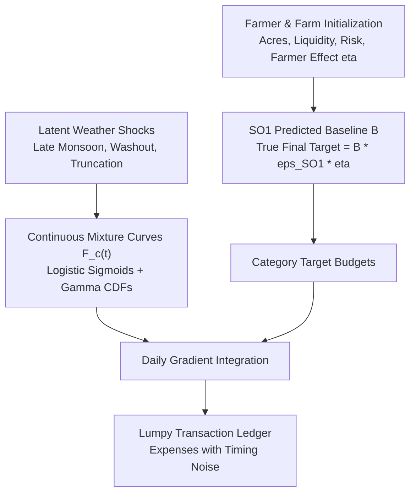

# Independent Daily-Spend Cultivation Simulator

**Status**: Specification & Synthetic Environment Documentation  
**Implementation**: [`ml/src/simulator/generator.py`](file:///D:/Aswanna/ml/src/simulator/generator.py)  
**Date**: October 2026  
**Tag**: `synthetic: true`  

---

## 1. Purpose & Design Philosophy

The purpose of [`DailySpendSimulator`](file:///D:/Aswanna/ml/src/simulator/generator.py) is to generate high-fidelity, daily-resolution financial cultivation streams. Exploratory phasing-prior research track. Evaluated on simulated data only (0 real cycles). Not wired into the live variance engine, which uses shared/phasing.js. Candidate for future integration behind a flag after validation on real DoA cycle data. End-of-season cost prediction belongs to SO1 and is not an SO3 deliverable.

### Decoupling Guarantee
To avoid circular validation or self-fulfilling recovery:
* The simulator **does not import** the survey prior generator ([`ml/src/build_phasing_priors.py`](file:///D:/Aswanna/ml/src/build_phasing_priors.py)).
* The simulator **does not use piecewise-linear knots** ($\tau \in \{0.0, 0.1, \dots, 1.0\}$).
* True spend trajectories are generated from smooth, continuous, nonlinear **mixtures of logistic sigmoids and Gamma cumulative distributions**.
* Discrete financial transactions are generated with lumpiness and timing noise around continuous spend gradients.

---

## 2. Generative Process & Mathematical Specification

### 2.1 Farm Initialization & Baseline Cost Generation
For each cycle $i$:
1. **Land Size**: $A \sim \text{Lognormal}(\mu=0.2, \sigma=0.4)$ clipped to $[0.5, 5.0]$ acres.
2. **Farmer Characteristics**:
   - `liquidity` $\in \{\text{low } (25\%), \text{medium } (55\%), \text{high } (20\%)\}$. Low liquidity introduces a 5-day purchase delay on non-urgent inputs.
   - `risk_attitude` $\in \{\text{risk\_averse } (30\%), \text{neutral } (50\%), \text{aggressive } (20\%)\}$.
   - **Farmer Efficiency Multiplier**: $\eta \sim \text{Lognormal}(0.0, 0.08)$ (reflects managerial quality, input bargaining power, and wastage).
3. **SO1 Baseline Prediction**:
   $$B = \text{BenchmarkPerAcre}(\text{Crop}) \times A \times \text{RegimeMultiplier}$$
   Standard benchmark for Paddy = LKR 145,000 / acre.
4. **SO1 Predictive Error**:
   $$\epsilon_{\text{SO1}} \sim \text{Lognormal}(0.0, \sigma=0.12)$$
   (Mimics SO1's measured $12\% - 15\%$ residual prediction error on out-of-sample farms).
5. **True Target Final Cost**:
   $$C^* = B \times \epsilon_{\text{SO1}} \times \eta$$

### 2.2 Latent Weather Shocks & Disruptions
* **Late Monsoon Delay**: Shifts land preparation and broadcasting by $+7$ to $+20$ days ($15\%$ base probability, $40\%$ under regime shift).
* **Fertilizer Wash-Out Shock**: Intense rainfall within days 20–35 washes away top-dressed urea, forcing emergency re-application ($+25\%$ fertilizer cost and a secondary pulse).
* **Early Failure Truncation**: Severe drought or flood causing complete crop abandonment at day $t_{\text{fail}} \in [35, 75]$ ($2\%$ base probability, $5\%$ under regime shift).

### 2.3 Category Phasing Dynamics (Nonlinear Mixtures)
For normalized cycle day $\tau = t / T$:
* **Seed**: Logistic burst centered at planting day:
  $$F_{\text{seed}}(t) = \sigma\left(35 \times (\tau - \tau_{\text{plant}})\right)$$
* **Fertilizer**: 3-pulse mixture (Basal: 26.4%, Top-dress 1: 40.0%, Top-dress 2: 33.6%):
  $$F_{\text{fert}}(t) = 0.264 \cdot \sigma_1(\tau - \tau_{\text{basal}}) + 0.400 \cdot \sigma_2(\tau - \tau_{\text{top1}}) + 0.336 \cdot \sigma_3(\tau - \tau_{\text{top2}})$$
  (Plus wash-out re-application pulse if triggered).
* **Agrochemical**: Incomplete Gamma cumulative distribution:
  $$F_{\text{agro}}(t) = \text{GammaCDF}(t; k=3.5, \theta)$$
* **Labour**: Continuous baseline + land prep pulse + weeding pulse + terminal harvest surge.
* **Machinery & Fuel**: Bimodal logistic bursts at land preparation ($60\%$) and combine harvesting ($40\%$).
* **Other**: Post-harvest packaging and transport surge at $\tau \ge 0.90$.

---

## 3. Information Asymmetry: What the Models Can NOT See

To guarantee honest and rigorous evaluation, downstream forecasting models operate under strict information constraints:

| Parameter | Observable by Models? | Notes / Latent Mechanism |
| :--- | :---: | :--- |
| **Daily Expense Stream** $\{(\text{day}, \text{cat}, \text{amt})\}$ | **YES** | Recorded in real-time ledger up to day $t$. |
| **Cycle Length $T$ & Crop** | **YES** | User profile registration attributes. |
| **SO1 Predicted Baseline $B$** | **YES** | Static regional prediction. |
| **True Farmer Multiplier $\eta$** | **NO** | Latent; models cannot tell if farmer is inherently thrifty or wasteful. |
| **SO1 Residual Error $\epsilon_{\text{SO1}}$** | **NO** | Latent; models cannot observe if $B$ was initially over- or under-estimated. |
| **Farmer Liquidity & Delay** | **NO** | Models only observe delayed expenses, not the underlying cause. |
| **Latent Weather Shocks** | **NO** | Models do not receive rain gauge or meteorological inputs. |
| **True Continuous Phasing $F_c^{\text{true}}(t)$** | **NO** | True Gamma/logistic parameters are hidden ground truth. |
| **Early Abandonment Risk** | **NO** | Models cannot forecast catastrophic truncation ahead of time. |
