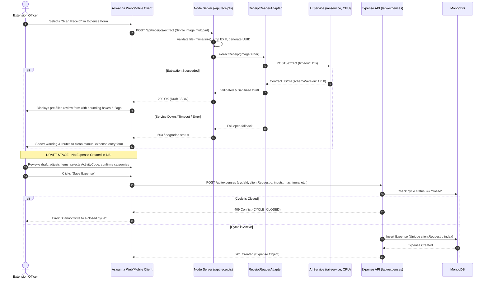

# Receipt Reader Architectural Design (SO3 Extension)

**Status**: APPROVED DESIGN ADDENDUM  
**Scope**: SO3 (Cost Tracking & Farm Financial Intelligence) Only  
**Target Services**: `/ai-service` (Python FastAPI), `/server` (Node.js API), `/shared/receipt` (Data Contract)  
**Author**: Senior Software Engineer  

---

## 1. Executive Summary & SO3 Scope

Within the Aswanna platform, **SO3** governs agricultural cost tracking, activity-based daily expense recording, baseline variance analysis, and tiered overspend alerting. 

The **Receipt Reader** is designed strictly as an **auxiliary accelerator** inside SO3 to extract structured cost items from photographed retail receipts (fertilizer slips, seed invoices, agrochemical receipts, fuel pump vouchers, machinery hire slips).

### Core Boundaries & Guardrails
1. **DRAFT ONLY**: The AI extraction output is strictly ephemeral and staged as a client-side or session draft. It **NEVER auto-creates or persists an `Expense`** in the primary ledger.
2. **Officer-in-the-Loop**: The extension officer must review, adjust line items, assign missing activity codes, confirm categories, and explicitly submit the expense through the standard, audited `POST /api/expenses` endpoint.
3. **Fail-Open Resilience**: If the AI service is offline, slow, or fails to parse a document, the system degrades seamlessly: the expense entry form remains 100% operational for manual entry without blocking the officer.
4. **Finite Taxonomies**: The extractor must strictly map line items to one of the 8 existing `CATEGORY_TAGS`. It **never invents new categories**; unrecognized items map to `null`.
5. **Integer LKR**: All financial amounts are integer Sri Lankan Rupees (LKR).
6. **No Silent Allocation**: Receipt-level adjustments (`discount`, `tax`) are never distributed or allocated silently across line items; line totals remain as extracted.

---

## 2. Decision Addendum & Phase 1 Scope Specifications

Based on stakeholder decisions, the following concrete architectural constraints are established:

| Dimension | Specification | Rationale & Architectural Rule |
| :--- | :--- | :--- |
| **Language & Script** | **Printed receipts, English + Sinhala only** (No Tamil in Phase 1) | Focuses engineering effort on the primary language distribution of commercial agrochemical and fertilizer dealers in pilot districts. |
| **Handwritten Scope** | **Documented limitation + separate error-analysis set** | Handwritten receipts (*බිල් පොත්*) are explicitly excluded from the model test split. They are tracked solely in a dedicated qualitative error-analysis dataset for future iterations. |
| **Compute & Hardware** | **CPU-only execution**, **p95 latency budget $\le 15\text{ s}$** | Must run cost-effectively on standard CPU server instances without requiring dedicated GPUs. |
| **Data Privacy & Locality**| **Zero external AI gateways / cloud APIs** | Receipt images and financial details stay 100% on local infrastructure. No data is dispatched to OpenAI, Google, AWS, or third-party OCR APIs. |
| **VLM Role** | **Optional local comparison only** | Vision-Language Models (e.g., local quantized Qwen2-VL) serve solely as an offline benchmark/research comparison, not in the production CPU request path. |
| **Image Retention** | **Default 7 days purge (configurable)** | Uploaded images are purged after 7 days (`RECEIPT_IMAGE_RETENTION_DAYS`). Confirmed expense records in MongoDB are permanent. |
| **Ingestion Cardinality** | **Single image per request** | `POST /extract` processes strictly one image file per request. Multi-page document stitching is deferred. |
| **Offline Handling** | **No offline image queue in Phase 1** | If offline or if the service fails, the client immediately routes the officer to manual expense entry. Offline queue is documented as future work. |
| **Spatial Bounding Boxes**| **Optional per-item `bbox` as $[x, y, w, h]$ in $[0, 1]$** | Normalised float coordinates allow the UI to render visual bounding box overlays during manual review. |
| **Adjustments & Totals** | **Receipt-level `discount` and `tax` (Integer LKR)** | Arithmetic check: $\sum \text{lineTotals} - \text{discount} + \text{tax} \equiv \text{printedTotal}$. Adjustments are never allocated across lines silently. |

---

## 3. High-Level Architecture & Interaction Flow

The Receipt Reader operates as an independent Python FastAPI microservice residing in `/ai-service`, communicating over HTTP with the Node.js backend via a single adapter file.

```mermaid
flowchart TD
    Client["Aswanna Web/Mobile Client (Officer UI)"]
    NodeServer["Node.js Server (Port 5000)"]
    Adapter["ReceiptReaderAdapter (server/src/adapters/receiptReaderAdapter.js)"]
    Storage["Secure Ephemeral Storage (Local / S3 / MinIO)"]
    AIService["AI Microservice: Python FastAPI (Port 8000, CPU-only)"]
    DB[("MongoDB (Primary Ledger)")]

    Client -->|"1. Upload single receipt image (multipart/form-data)"| NodeServer
    NodeServer -->|"2. Validate MIME/size, strip EXIF, save UUID"| Storage
    NodeServer -->|"3. Call extractReceipt(imageBuffer)"| Adapter
    Adapter -->|"4. POST /extract (timeout: 15s budget)"| AIService
    
    alt AI Service Healthy (<15s)
        AIService -->|"5. Return JSON extraction contract"| Adapter
        Adapter -->|"6. Sanitize against shared/receipt/schema.js"| NodeServer
        NodeServer -->|"7. Return DRAFT payload (schemaVersion: 1.0.0)"| Client
    else AI Service Down / Timeout (>15s) / Offline
        Adapter -->|"5b. Catch error, fail-open fallback"| NodeServer
        NodeServer -->|"6b. Return 503 / degraded status -> route to manual form"| Client
    end

    Client -->|"8. Officer reviews, edits, selects ActivityCode"| Client
    Client -->|"9. POST /api/expenses (clientRequestId, cycleId)"| NodeServer
    NodeServer -->|"10. Validate Cycle Status & Idempotency"| DB
```

---

## 4. Extraction Output Contract (`shared/receipt/schema.js`)

All communication between `/ai-service`, `server`, and `client` is governed by version `1.0.0` of the extraction contract.

### 4.1. Contract JSON Schema Example

```json
{
  "schemaVersion": "1.0.0",
  "documentDate": "2026-10-15",
  "supplier": "Dambulla Agro Chemicals (Pvt) Ltd",
  "language": "si",
  "items": [
    {
      "description": "Urea 50kg bag",
      "quantity": 2,
      "unit": "bag",
      "unitPrice": 8500,
      "lineTotal": 17000,
      "categoryTag": "fertilizer",
      "confidence": 0.94,
      "bbox": [0.12, 0.45, 0.76, 0.04]
    },
    {
      "description": "Sprayer Nozzle Brass",
      "quantity": 1,
      "unit": "nos",
      "unitPrice": 1200,
      "lineTotal": 1200,
      "categoryTag": "machinery",
      "confidence": 0.88,
      "bbox": [0.12, 0.50, 0.76, 0.04]
    },
    {
      "description": "Protective Gloves",
      "quantity": 2,
      "unit": "pair",
      "unitPrice": 450,
      "lineTotal": 900,
      "categoryTag": null,
      "confidence": 0.72,
      "bbox": [0.12, 0.55, 0.76, 0.04]
    }
  ],
  "discount": 500,
  "tax": 0,
  "printedTotal": 18600,
  "computedTotal": 18600,
  "flags": [
    {
      "code": "UNKNOWN_CATEGORY",
      "field": "items[2].categoryTag",
      "message": "Unrecognized category mapped to null. Requires officer review."
    }
  ],
  "overallConfidence": 0.85
}
```

### 4.2. Field Invariants

| Field | Type | Required | Constraints & Validation Rules |
| :--- | :--- | :---: | :--- |
| `schemaVersion` | `string` | Yes | Fixed semver string (e.g. `"1.0.0"`). |
| `documentDate` | `string \| null` | Yes | ISO date string (`YYYY-MM-DD`) or `null`. Must not be in the future. |
| `supplier` | `string \| null` | Yes | Normalized merchant name or `null`. |
| `language` | `string` | Yes | Phase 1 restricted: `['si', 'en', 'mixed', 'unknown']`. Tamil flagged as unsupported. |
| `items` | `Array<Item>` | Yes | List of extracted line items. May be empty `[]` if unreadable. |
| `items[].description`| `string` | Yes | Extracted item name/description. |
| `items[].quantity` | `number \| null`| Yes | Quantity $\ge 0$ or `null`. |
| `items[].unit` | `string \| null`| Yes | Standardized unit (`kg`, `l`, `bag`, `nos`, `pkt`) or `null`. |
| `items[].unitPrice` | `integer \| null`| Yes | **Integer LKR** (no decimal cents) $\ge 0$ or `null`. |
| `items[].lineTotal` | `integer \| null`| Yes | **Integer LKR** $\ge 0$ or `null`. |
| `items[].categoryTag`| `string \| null`| Yes | **Strictly one of 8 `CATEGORY_TAGS`** (`seed`, `fertilizer`, `agrochemical`, `labour`, `machinery`, `fuel`, `irrigation`, `other`). Unknown maps to `null`. |
| `items[].confidence` | `number` | Yes | Float in range $[0.0, 1.0]$. Values $< 0.6$ trigger `LOW_CONFIDENCE` flag. |
| `items[].bbox` | `number[4] \| null`| Optional | Normalised coordinates $[x, y, w, h]$ with each float $\in [0.0, 1.0]$. |
| `discount` | `integer \| null`| Optional | Receipt-level discount in **Integer LKR** $\ge 0$. Defaults to `0` in math. |
| `tax` | `integer \| null`| Optional | Receipt-level tax/vat in **Integer LKR** $\ge 0$. Defaults to `0` in math. |
| `printedTotal` | `integer \| null`| Yes | **Integer LKR** printed on receipt or `null`. |
| `computedTotal` | `integer \| null`| Yes | Calculated as $\max(0, \sum \text{items[].lineTotal} - \text{discount} + \text{tax})$. |
| `flags` | `Array<Flag>` | Yes | Discrepancy flags (`{ code, field, message }`). |
| `overallConfidence` | `number` | Yes | Aggregate document confidence $[0.0, 1.0]$. |

### 4.3. Arithmetic Validation Rule
The computed total verifies receipt arithmetic:
$$\text{computedTotal} = \left(\sum_{i} \text{items}[i].\text{lineTotal}\right) - (\text{discount} \parallel 0) + (\text{tax} \parallel 0)$$

* If $\text{printedTotal} \neq \text{null}$ and $\text{computedTotal} \neq \text{null}$ and $\text{printedTotal} \neq \text{computedTotal}$, the system emits `RECEIPT_FLAG_CODES.TOTAL_MISMATCH`.
* **Zero Silent Allocation**: Line item costs are preserved verbatim as parsed. The discount and tax are **never silently apportioned or distributed** across line items.

---

## 5. Microservice & Adapter Architecture

### 5.1. Python FastAPI Service (`/ai-service`)
* **Execution**: CPU-only pipeline (ONNX Runtime, Tesseract / PaddleOCR CPU builds).
* **Latency Budget**: p95 $\le 15\text{ s}$.
* **Locality**: 100% self-hosted, offline-capable inside the deployment cluster. No external calls.
* **Endpoints**:
  * `GET /health`: Liveness probe reporting status, uptime, device (`cpu`), and model readiness.
  * `POST /extract`: Accepts single-file `multipart/form-data` (`file`). Returns Contract JSON.

### 5.2. Node.js Adapter (`server/src/adapters/receiptReaderAdapter.js`)
* **Single Point of Ingestion**: Only this adapter is permitted to call `/ai-service`.
* **Timeout & Circuit Breaker**: Strict 15-second request timeout matching the p95 latency budget.
* **Fail-Open Policy**: On `ECONNREFUSED`, timeout, or 5xx, catches errors and returns `{ available: false, fallback: 'manual' }`.
* **Validation**: Passes raw AI output through `validateReceiptExtraction()` from `shared/receipt/schema.js`.

---

## 6. Business Rules & Safety Invariants



### Invariants Enforced
1. **Never Auto-Create**: Receipt scanning produces an in-memory draft returned to the client. No database insertion occurs until the officer submits the form.
2. **Standard Expense Endpoint**: Confirmation uses the existing `POST /api/expenses` endpoint.
3. **Closed Cycle Protection (409)**: If the target farming cycle has transitioned to `closed`, `CYCLE_CLOSED` (409) is returned.
4. **Idempotency**: Unique `clientRequestId` (UUID) ensures network retries cannot create duplicate expense entries.

---

## 7. Storage, Security & Retention

1. **Size & MIME Limits**: Max 10 MB per image. Strictly `image/jpeg`, `image/png`, `image/webp`, `image/heic`.
2. **Filename Randomization**: Files are saved with cryptographically random UUIDs (`crypto.randomUUID() + ext`). Original filenames are immediately discarded.
3. **EXIF Stripping**: All GPS coordinates, device identifiers, and timestamp EXIF tags are stripped upon receipt.
4. **Retention Policy**:
   * Default: **7 days** (`RECEIPT_IMAGE_RETENTION_DAYS = 7`).
   * Automated daily cron purges image files older than retention days.
   * Confirmed expense ledger records in MongoDB are **permanent**.
   * Optional ephemeral mode (`RECEIPT_EPHEMERAL_MODE=true`): In-memory buffer only, zero disk writes.

---

## 8. Documented Limitations & Future Work

1. **Handwritten Slips (*බිල් පොත්*)**: Documented as an explicit Phase 1 limitation. Handwritten receipts will be collected into a separate error-analysis dataset and evaluated for post-Phase 1 models.
2. **Tamil Language Support**: Phase 1 targets English and Sinhala printed receipts. Tamil OCR support is slated for Phase 2.
3. **Offline Image Queue**: In Phase 1, connectivity loss routes the officer immediately to manual entry. An offline background synchronization queue for receipt images is documented for future mobile releases.
4. **Multi-Page Slips**: Phase 1 restricts ingestion to a single image per request. Multi-page document aggregation is deferred.
