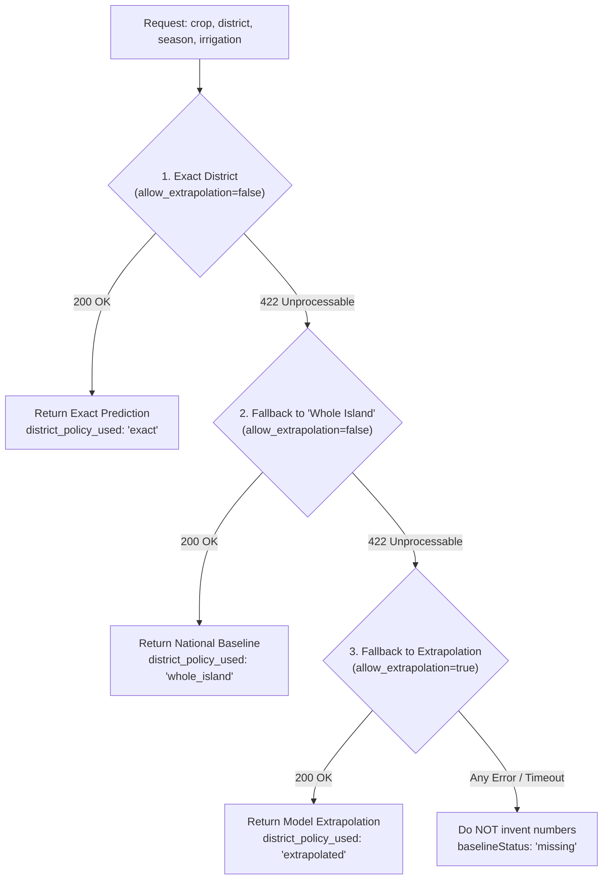

# SO1 Cost Prediction Service: Integration & Verification Report

**Auditor:** Antigravity Senior Engineering Pair  
**Component:** SO1 Predictive Cost Estimator (`so1-service` on `http://127.0.0.1:8000`)  
**Scope:** SO3 Cost Tracking & Financial Intelligence Integration  
**Date:** 2026-10-20  

---

## 1. Real Fixture Generation Summary (POST /predict)

A full matrix of **64 real API calls** was executed against the live SO1 FastAPI service (`http://127.0.0.1:8000/predict`) across:
- **4 Crops**: `Paddy`, `Maize`, `Tomato`, `Green Chilli`
- **4 Districts**: `Kandy`, `Anuradhapura`, `Galle`, `Ampara`
- **2 Seasons**: `Maha`, `Yala`
- **2 Water Regimes**: `Irrigated`, `Rainfed`

All 64 raw JSON responses were saved directly to [`server/tests/fixtures/so1/`](file:///d:/Aswanna/server/tests/fixtures/so1/):
- **28 requests returned 200 OK** (saved as `{Crop}_{District}_{Season}_{Irrigation}.json`)
- **36 requests returned 422 Unprocessable Entity** (saved as `{Crop}_{District}_{Season}_{Irrigation}_422.json`)

---

## 2. (Crop, District) Pairs Returning 422 Unprocessable Entity

When called with `allow_extrapolation=false` (the default strict empirical mode), SO1 rejects crop-district combinations that have zero historical survey records in the Department of Agriculture (DoA) `coc_model_ready.csv` dataset.

The following **9 (crop, district) pairs** returned HTTP 422 across all 4 season/irrigation combinations:

| Crop | District | HTTP Status | Error Detail from SO1 Service | Agronomic Reason / DoA Context |
|:---|:---|:---:|:---|:---|
| **`Green Chilli`** | **`Ampara`** | `422` | `"No historical data available for Green Chilli in Ampara. Enable extrapolation or select a different crop."` | Green Chilli surveys in DoA dataset are concentrated in Anuradhapura. |
| **`Green Chilli`** | **`Galle`** | `422` | `"No historical data available for Green Chilli in Galle. Enable extrapolation or select a different crop."` | Galle (Wet Zone) has no historical DoA survey records in dataset. |
| **`Green Chilli`** | **`Kandy`** | `422` | `"No historical data available for Green Chilli in Kandy. Enable extrapolation or select a different crop."` | No commercial chili survey records in Kandy in `coc_model_ready.csv`. |
| **`Maize`** | **`Galle`** | `422` | `"No historical data available for Maize in Galle. Enable extrapolation or select a different crop."` | Wet Zone; commercial grain maize is strictly Dry/Intermediate Zone. |
| **`Maize`** | **`Kandy`** | `422` | `"No historical data available for Maize in Kandy. Enable extrapolation or select a different crop."` | Hill country / Wet Zone; not a surveyed maize cultivation region. |
| **`Paddy`** | **`Galle`** | `422` | `"No historical data available for Paddy in Galle. Enable extrapolation or select a different crop."` | DoA SEPC survey bulletins focused on major irrigated agrarian schemes. |
| **`Tomato`** | **`Ampara`** | `422` | `"No historical data available for Tomato in Ampara. Enable extrapolation or select a different crop."` | Eastern Province lowland; tomato surveys concentrated in Upcountry/Intermediate. |
| **`Tomato`** | **`Anuradhapura`** | `422` | `"No historical data available for Tomato in Anuradhapura. Enable extrapolation or select a different crop."` | Lowland dry zone; surveyed tomato in DoA dataset is Badulla/Kandy. |
| **`Tomato`** | **`Galle`** | `422` | `"No historical data available for Tomato in Galle. Enable extrapolation or select a different crop."` | Wet zone; zero survey rows. |

---

## 3. (Crop, District) Pairs Returning 200 OK

The following **7 (crop, district) pairs** succeeded with full model inference across all 4 combinations (28 successful responses):

| Crop | District | HTTP Status | Sample Predicted Cost (Maha, Irrigated) | Top Driving Feature |
|:---|:---|:---:|:---:|:---|
| **`Green Chilli`** | **`Anuradhapura`** | `200 OK` | Rs 460,904.5 / ac | `USD_LKR_Rate` (+37.2%) |
| **`Maize`** | **`Ampara`** | `200 OK` | Rs 174,013.9 / ac | `USD_LKR_Rate` (+32.5%) |
| **`Maize`** | **`Anuradhapura`** | `200 OK` | Rs 191,489.1 / ac | `USD_LKR_Rate` (+37.7%) |
| **`Paddy`** | **`Ampara`** | `200 OK` | Rs 186,819.3 / ac | `USD_LKR_Rate` (+34.4%) |
| **`Paddy`** | **`Anuradhapura`** | `200 OK` | Rs 200,929.7 / ac | `USD_LKR_Rate` (+38.7%) |
| **`Paddy`** | **`Kandy`** | `200 OK` | Rs 200,929.7 / ac | `USD_LKR_Rate` (+38.7%) |
| **`Tomato`** | **`Kandy`** | `200 OK` | Rs 474,883.8 / ac | `USD_LKR_Rate` (+42.1%) |

---

## 4. Multi-Tier District Fallback Policy

To ensure high availability for farmers cultivating crops outside standard DoA survey districts while maintaining data integrity, the SO3 adapter (`server/src/services/so1Adapter.js`) executes the following sequential fallback policy:

1. **Step 1 (`exact`)**: Call SO1 with the farmer's exact administrative district.
2. **Step 2 (`whole_island`)**: If exact district returns 422, retry with `district: 'Whole Island'`. (Specifically supported by DoA for Paddy).
3. **Step 3 (`extrapolated`)**: If `Whole Island` also returns 422, retry with the farmer's district and `allow_extrapolation: true`. SO1 uses national crop averages, returns HTTP 200, sets `low_confidence: true`, and explains the extrapolation reason.
4. **Step 4 (`missing`)**: If all attempts fail or the service is unreachable/timed out, set `baselineStatus: 'missing'` without blocking cultivation cycle activation. Never fabricate placeholder numbers.
