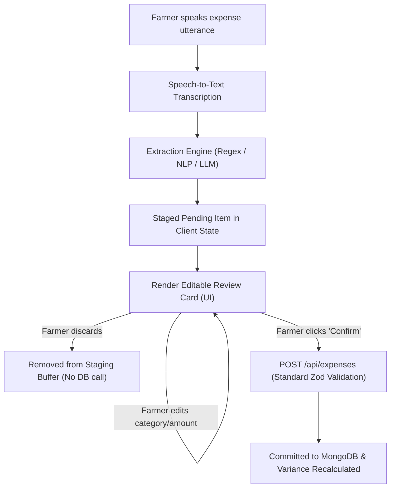

# Voice-Based Expense Entry: Architecture & Discovery Report (Task V0)

> [!NOTE]
> Discovery and design document for voice-based expense entry in Aswanna SO3.
> Scope: Read-only architectural discovery, speech engine evaluation, extraction schema design, and draft fixtures.
> No feature code has been implemented in this phase. Existing variance and alert engines remain untouched.

---

## 1. Inventory & Baseline Architecture

### 1.1 Expense Form Components & UI Ledger
The current expense logging workflow consists of the following components:
- **`client/src/components/ExpenseModal.jsx`**:
  The primary entry modal for farmer expenses. It maintains form state for:
  - `entryDate`: ISO date string (defaulting to today).
  - `activityCode`: Reference ID to agricultural activity (e.g., land preparation, sowing, weeding).
  - `inputs`: Array of physical inputs `[{ inputType, categoryTag, quantity, unit, cost }]`.
  - `machinery`: Object `{ method, unitPrice, quantity, cost }`.
  - `labour`: Object `{ familyLabour, hiredLabour, dailyWage, cost }`.
  - `other`: Object `{ description, amount }`.
  - `dayStatus`: `'worked' | 'no_work'`.
  Validation is evaluated before dispatching API requests to `/api/expenses`.
- **`client/src/pages/Expenses.jsx`**:
  The parent ledger view that renders expense tables, date filtering, pagination, aggregate spend metrics, and the button triggering `ExpenseModal`.
- **`client/src/components/CostBreakdown.jsx`**:
  Renders actual vs baseline category distributions using the 8 canonical categories.

### 1.2 Expense Model & API Schema
- **Database Model (`server/src/models/Expense.js`)**:
  - Fields: `cycleId` (ObjectId, ref `CropCycle`), `entryDate` (Date), `activityCode` (ObjectId, ref `ActivityCode`), `inputs` (array of sub-documents), `machinery` (sub-document), `labour` (sub-document), `other` (sub-document), `subtotals` (cached sums), `totalAmount` (Number), `dayStatus` (`'worked' | 'no_work'`), `notes` (String), `createdBy` (ObjectId, ref `User`).
  - Compound idempotency index: `{ cycleId: 1, clientRequestId: 1 }` (unique, sparse), preventing duplicate submissions upon retry.
  - Calculation logic: Total amounts and category subtotals are computed by `shared/calc.js` (`calculateCostSheetTotals`).
- **Validation Schema (`server/src/schemas/expenseSchemas.js` / `shared/formSchemas/costSheet.js`)**:
  - Validated via Zod on creation and update. Requires valid MongoDB ObjectIds, validated date strings, positive numeric values for quantities/costs, and requires `activityCode` when `dayStatus === 'worked'`.
- **API Endpoints (`server/src/routes/expenses.js`)**:
  - `POST /api/expenses`: Creates expense entry. Requires authenticated session (`requireAuth`), checks cycle status (`CYCLE_CLOSED` rejection), and verifies ownership (`assertOwnership(req.user, { farmerId: cycle.farmerId })`).
  - `GET /api/expenses`: Queries cycle expenses with pagination and date filters.
  - `GET /api/expenses/:id`: Fetches a single expense entry.
  - `PUT /api/expenses/:id`: Updates an existing entry, recomputing totals and re-checking open cycle status.
  - `DELETE /api/expenses/:id`: Deletes an entry.

### 1.3 Canonical Categories (The 8 SO3 Categories)
The SO3 variance engine (`shared/variance.js`), alert service (`server/src/services/alertService.js`), and SO1 baseline mapping (`shared/config/so1Mapping.js`) strictly operate on **8 canonical categories**:
1. `seed`: Seed paddy, vegetable seed packs, nursery seedlings (inputs with `categoryTag: 'seed'`).
2. `fertilizer`: Chemical fertilizers (Urea, TSP, MOP) and organic manure (inputs with `categoryTag: 'fertilizer'`).
3. `agrochemical`: Herbicides, pesticides, fungicides, and weedicides (inputs with `categoryTag: 'agrochemical'`).
4. `labour`: Hired labour wages for farm tasks (`labour.cost`).
5. `machinery`: Tractor, combine harvester, rotavator, or thresher hire (`machinery.cost`).
6. `fuel`: Diesel or petrol for water pumps, tillers, and machinery (inputs with `categoryTag: 'fuel'`).
7. `irrigation`: Water board fees, canal levies, water bowser rental (inputs with `categoryTag: 'irrigation'`).
8. `other`: Consumables, gunny bags, twine, fence wire, sprayer maintenance (`other.amount`).

> [!IMPORTANT]
> Any voice extraction pipeline MUST map parsed items into one or more of these exact 8 categories to maintain zero regressions in the variance and alert engines.

### 1.4 Internationalization (i18n) Status
- Configured in `client/src/i18n/i18n.js` with `react-i18next`.
- Available translation bundles:
  - English: `client/src/i18n/locales/en.json`
  - Sinhala: `client/src/i18n/locales/si.json`
- **Tamil (`ta` / `ta-LK`) is NOT present** in the repository. Introducing Tamil voice transcription requires defining whether Tamil transcripts are displayed alongside English/Sinhala UI strings, or if full Tamil localization (`ta.json`) will be authored.

---

## 2. Client-Side Pending Workflow (Zero DB Writes until Confirmed)

To prevent accidental database mutations or corrupted expense records caused by speech recognition misinterpretations, voice-entered items must live in client memory as a pending staging buffer.

### 2.1 State Management Pattern


### 2.2 Pending Item Data Contract
The pending item lives in React state (e.g. `const [pendingItems, setPendingItems] = useState([])` or an offline-capable `sessionStorage` / IndexedDB buffer):

```ts
interface PendingVoiceItem {
  tempId: string;                // UUID generated on client
  transcript: string;            // Raw transcript from speech engine
  confidence: number;            // Recognition confidence score (0.0 to 1.0)
  detectedLanguage: 'en' | 'si' | 'ta' | 'mixed';
  extractedExpense: {
    categoryTag: 'seed' | 'fertilizer' | 'agrochemical' | 'labour' | 'machinery' | 'fuel' | 'irrigation' | 'other';
    description: string;
    quantity: number | null;
    unit: string | null;
    cost: number;
    entryDate: string;           // ISO YYYY-MM-DD
    dayStatus: 'worked';
  };
  validationStatus: 'valid' | 'warning' | 'error';
  validationMessage?: string;
  isConfirmed: boolean;
}
```

### 2.3 UX Safety Guarantees
1. **Explicit Confirmation**: No network request is dispatched to `/api/expenses` while the farmer is speaking or reviewing.
2. **In-Place Corrections**: The farmer can click any field on the review card (e.g., adjust cost if "14,000" was heard as "4,000", or correct "diesel" to "fuel").
3. **Idempotency Protection**: When confirmed, each item sends a client-generated `clientRequestId` to `POST /api/expenses`, preventing double-billing on network hiccups.

---

## 3. Auth & Rate-Limiting Setup for Voice Endpoints

### 3.1 Authentication
- The application uses JWT Bearer authentication (`server/src/middleware/auth.js`, `requireAuth`).
- The JWT is verified using `jwt.verify(token, env.JWT_SECRET)` and sets `req.user` (`{ id, role, farmerId }`).
- Any new server-side voice proxy endpoint (e.g., `POST /api/voice/transcribe` or `POST /api/voice/extract`) **must attach `requireAuth`**. Unauthenticated calls must be rejected immediately with `401 Unauthorized` to prevent abuse of external cloud speech quotas.

### 3.2 Rate Limiting
- Configured in `server/src/app.js` via `express-rate-limit`.
- Existing limits:
  - `writeLimiter`: Applied to write verbs (`POST|PUT|PATCH|DELETE`), configured at 1,000 requests per 15 minutes.
  - `authLimiter`: 20 requests per 15 minutes for authentication.
- **Recommended Voice Rate Limiter**:
  - Cloud STT APIs (OpenAI Whisper or Google Cloud) incur per-minute costs ($0.006 – $0.016/min).
  - A specialized `voiceLimiter` must be created:
    - Limit: **30 requests per 15 minutes per user**.
    - Payload size limit: Maximum **10 MB** for audio uploads (via `multer` or raw audio buffer) to prevent heap overflow and denial-of-service.

---

## 4. Speech Recognition Provider Evaluation Matrix

Every claim in this section is based on live documentation fetched from official provider resources.

| Feature / Dimension | Browser Web Speech API | OpenAI Whisper (`whisper-1` / Open-Source) | Google Cloud Speech-to-Text (V2 / Chirp) |
| :--- | :--- | :--- | :--- |
| **Cited Sources** | [MDN Web Speech API](https://developer.mozilla.org/en-US/docs/Web/API/SpeechRecognition)<br>[Chrome Speech Demo](https://www.google.com/intl/en/chrome/demos/speech.html) | [OpenAI Speech-to-Text Guide](https://platform.openai.com/docs/guides/speech-to-text)<br>[Whisper Tokenizer Languages](https://raw.githubusercontent.com/openai/whisper/main/whisper/tokenizer.py) | [Google STT Languages](https://cloud.google.com/speech-to-text/docs/languages)<br>[Google STT Pricing](https://cloud.google.com/speech-to-text/pricing)<br>[Google Data Logging Policy](https://cloud.google.com/speech-to-text/docs/data-logging) |
| **Supported Browsers** | Chrome/Edge (Desktop & Android). Safari (iOS 14.5+, macOS 14.1+ via `webkitSpeechRecognition`). **Not supported in Firefox** (disabled by default). | Browser-independent (server-side REST endpoint). Works in all modern browsers. | Browser-independent (server-side REST / gRPC endpoint). Works in all modern browsers. |
| **Sinhala (`si-LK`)** | Supported in Chrome / Chromium. | Supported (`si` language code in Whisper 98-language dictionary). | Supported (`si-LK` language code in V1 and V2 models). |
| **Tamil (`ta-LK`)** | Supported in Chrome / Chromium (`ta-LK` locale). | Supported (`ta` language code in Whisper dictionary). | Supported (`ta-LK` language code in V1 and V2 models). |
| **English (`en-LK`/`en-US`)** | Supported across all supported browsers. | Supported (`en` language code). | Supported (`en-US`, `en-IN`, `en-GB`). |
| **Cost** | **Free** (built into browser engine). | **$0.006 per minute** ($0.36 / audio hour) for hosted API.<br>Free for self-hosted open-source model. | **$0.016 per minute** ($0.96 / audio hour) for standard V2 / Chirp.<br>Discounted to $0.003/min for batch. |
| **Data Privacy & Transmission** | **Sends audio to vendor servers** (Google servers in Chrome; Apple servers in Safari). Cannot run locally. | **Hosted**: Audio processed on OpenAI servers; by default, API customer data is not used for model training; 30-day retention for abuse.<br>**Self-hosted**: 100% on-premises, 0 external transmission. | **Default**: Data logging is OFF. Audio and transcripts are not logged, stored, or used for model training.<br>**Opt-in**: Discount available if opting into model training. |
| **Offline Ability** | **No** (Chrome requires active internet connection to transcribe speech). | **Hosted**: No.<br>**Self-hosted**: **Yes**, completely offline capable with local GPU / CPU inference. | **Cloud API**: No.<br>**On-Prem**: Available via GKE Enterprise (Anthos), but high hardware/license overhead. |

> [!NOTE]
> **Items Not Verified / Limitations**:
> 1. Exact acoustic accuracy (Word Error Rate / WER) on rural Sri Lankan agricultural dialects (e.g. Rajarata Sinhala, Batticaloa Tamil) could not be benchmarked without empirical field recordings.
> 2. Firefox on Android does not support Web Speech API regardless of configuration flags.

---

## 5. Proposed Extraction Schema & Category Mapping

### 5.1 Extraction Output Schema (JSON)
When an utterance is transcribed, the NLP/LLM extraction layer must produce structured JSON conforming to:

```json
{
  "categoryTag": "seed | fertilizer | agrochemical | labour | machinery | fuel | irrigation | other",
  "inputType": "seed | fertilizer | agrochemical | fuel | irrigation | null",
  "description": "string (readable summary of item/activity)",
  "quantity": "number | null",
  "unit": "string | null (e.g., bags, kg, L, hours, service, laborers)",
  "cost": "number (amount in Sri Lankan Rupees - LKR)",
  "dayStatus": "worked | no_work",
  "confidence": "number (0.0 to 1.0)"
}
```

### 5.2 Category Mapping Rules
Conversational agricultural terms map to the 8 canonical categories according to these strict rules:

| Category Tag | Keywords & Agricultural Terms (EN / SI / TA) | Example Utterance |
| :--- | :--- | :--- |
| **`seed`** | Seed paddy, variety codes (BG 358, BG 300, AT 362), seedling trays, onion seeds.<br>SI: `බීජ වී`, `බීජ`, `පැල`.<br>TA: `விதை நெல்`, `விதை`, `நாற்று`. | "Bought 30 kilos of BG 358 seed paddy for 7500" |
| **`fertilizer`** | Urea, TSP (triple superphosphate), MOP (muriate of potash), compost, fertilizer bags.<br>SI: `යූරියා`, `පොහොර`, `ටීඑස්පී`, `එම්ඕපී`, `මිටි`.<br>TA: `யூரியா`, `உரம்`, `மூட்டை`. | "යූරියා මිටි දෙකක් ගත්තා රුපියල් දාහතරදාහයි" |
| **`agrochemical`** | Weedicide, herbicide, pesticide, insecticide, fungicide, spray bottle, Nominee, Regent.<br>SI: `වල් නාශක`, `කෘමිනාශක`, `දිලීර නාශක`, `බෙහෙත් දියර`.<br>TA: `களைநாசினி`, `பூச்சி மருந்து`. | "Purchased Nominee weedicide spray bottle for 4200 rupees" |
| **`labour`** | Daily wage, hired labour, weeding labour, transplanting labour, fertilizer spreading.<br>SI: `කුලී කම්කරුවන්`, `දවසේ කුලිය`, `කුලියට`.<br>TA: `கூலி ஆட்கள்`, `கூலி வேலை`. | "களை எடுக்க வந்த கூலி ஆட்களுக்கு 6000 ரூபாய் கூலி கொடுத்தேன்" |
| **`machinery`** | Tractor, 2-wheel tractor, combine harvester, rotavator, thresher hire, land prep.<br>SI: `ට්‍රැක්ටර්`, `හාවස්ටර්`, `රොටවෙටර්`, `හාම`.<br>TA: `டிராக்டர்`, `அறுவடை இயந்திரம்`, `உழவு`. | "Tractor plowing ekata 8500k gewwa" |
| **`fuel`** | Diesel, petrol, fuel for water pump, power tiller diesel.<br>SI: `ඩීසල්`, `පෙට්‍රල්`, `ඉන්ධන`.<br>TA: `டீசல்`, `பெட்ரோல்`. | "Spent 3800 rupees on diesel for the water bowser pump" |
| **`irrigation`** | Canal water fee, water board maintenance levy, water bowser rental.<br>SI: `වාරිමාර්ග ගාස්තු`, `ඇල මාර්ග`, `වතුර බදු`.<br>TA: `பாசன வரி`, `வாய்க்கால் நீர்`. | "வாய்க்கால் நீர் பாசன வரி 2500 ரூபாய் கட்டினேன்" |
| **`other`** | Consumables, gunny sacks, jute bags, packing twine, fence wire, sprayer repair parts.<br>SI: `ගෝනි`, `ලණු`, `කම්බි`, `අලුත්වැඩියා`.<br>TA: `சாக்கு பைகள்`, `கயிறு`, `பழுது பார்த்தல்`. | "Bought PVC pipe joint fittings and repair glue for 1800" |

### 5.3 Draft Evaluation Fixtures
A benchmark dataset of **40 realistic farmer phrases** has been created and saved at:
[`server/eval/fixtures/voice/phrases.draft.json`](file:///d:/Aswanna/server/eval/fixtures/voice/phrases.draft.json).

- **Distribution**:
  - 10 English phrases (`VP-EN-001` to `VP-EN-010`)
  - 15 Sinhala phrases (`VP-SI-011` to `VP-SI-025`)
  - 10 Tamil phrases (`VP-TA-026` to `VP-TA-035`)
  - 5 Mixed / Code-switched Singlish and Tanglish phrases (`VP-MX-036` to `VP-MX-040`)
- **Review Marker**: Every record is tagged with `"review_status": "DRAFT: needs native-speaker review"`.

### 5.4 Interim Safety Policy: Sinhala Number Words (Task V5.3)
Until `shared/voice/sinhalaNumberWords.json` is reviewed and verified by a native Sinhala speaker:
- Any amount parsed from Sinhala number **words** (e.g. `අටදාස් පන්සියයක්`, `හයදාහක්`, `දාහතරදාහයි`) receives `status: 'needs_review'` with blocking reason `'amount_from_words_verify'`.
- The parsed numeric value is preserved as `totalAmount` and displayed prominently in the review table (e.g. `Rs. 8,500`) with an explicit "Accept amount" tap button.
- Digit amounts (including suffixed digits like `8500ක්`, `6800ට`, `1900`) and English number expressions remain unaffected and can resolve directly to `status: 'ok'`.
- Strict grammar consumption: the Sinhala number parser must fully consume the entire candidate number phrase. Any unrecognized or leftover token immediately adjacent to or within the number phrase aborts parsing with `amount_unresolved`.

---

## 6. Open Decisions for the System Owner

1. **Speech Engine & Operating Cost Strategy**:
   - *Option A (Browser Web Speech API)*: Zero cloud STT operating costs, but excludes Firefox users, cannot work offline, and offers no control over recognition models for code-switched phrases.
   - *Option B (OpenAI Whisper Hosted API)*: Highly cost-effective ($0.006/min; ~LKR 1.80 per minute), handles code-switching smoothly, but requires backend proxy infrastructure and external internet connectivity.
   - *Option C (Google Cloud Speech-to-Text)*: Highly customized for `si-LK` / `ta-LK` regional locales, but costs ~$0.016/min (~LKR 4.80 per minute).
   - *Decision needed*: Which transcription backend should be targeted for the MVP?

2. **Primary Language Rollout & Tamil Localization**:
   - Aswanna currently only has translation catalogs for English (`en.json`) and Sinhala (`si.json`).
   - Tamil is critical for farmers in the Eastern and Northern provinces (Batticaloa, Ampara, Jaffna, Vavuniya).
   - *Decision needed*: Should voice entry launch with English and Sinhala first, or should a Tamil localization bundle (`ta.json`) be created simultaneously?

3. **Audio Data Retention & Privacy Policy**:
   - Under Sri Lankan Personal Data Protection Act (PDPA) No. 9 of 2022, voice biometrics and audio recordings require explicit consent and data minimization.
   - *Option A (Zero Retention)*: Audio streams are transcribed in memory and immediately discarded.
   - *Option B (Storage for Fine-Tuning)*: Audio clips are stored in encrypted cloud storage (S3/GCS) to train localized agricultural speech models.
   - *Decision needed*: Does the project mandate an in-memory zero-retention policy, or should an opt-in audio storage policy be introduced?

---

## 7. Changelog

- **2026-10-26 (Task V5.4)**: Owner decision on draft fixtures: corrected expected `quantity` and `unit` to `null` for `VP-SI-012`, `VP-SI-014`, `VP-SI-017`, and `VP-SI-022` in `server/eval/fixtures/voice/dev.json`. These four were label errors found when a silent error was diagnosed where the spoken text contained no count or unit word. No other labels were changed.
